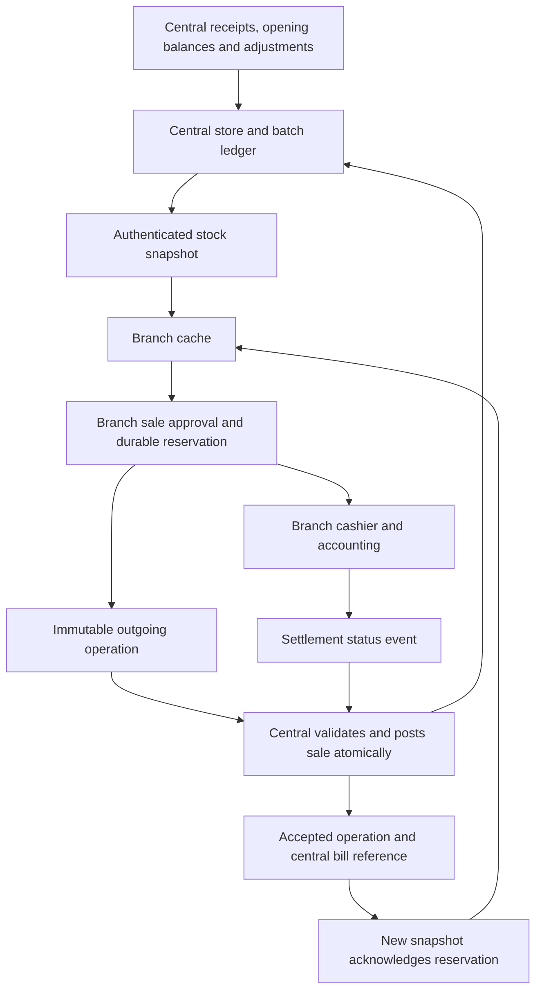

# Current inventory centralization workflow

Code baseline: November 10, 2026; Central Synchronization and Branch
Synchronization manifest version 19.0.5.1.0. This document describes the inspected
central checkout and the branch checkout at
`/opt/odoo19/custom-addons-branch19`. It is a code-based operating reference,
not evidence that a particular database has been upgraded or that its jobs are
running. Confirm installed modules, job intervals, permissions, and stock on the
target environment before applying the operating procedures.

Audience: inventory operations, branch/POS support, and engineering.
For the proposed conversion consolidation, see
[UoM conversion transition](uom_conversion_transition.md).

Use the ownership, connection and delivery sections for the system overview;
the responsibilities and central stock lifecycle sections for setup and stock
entry; and the daily operations/recovery section for support procedures.

## Workflow at a glance

The cache is a downloaded view of central inventory. A reservation is a local
deduction against that view until a snapshot acknowledges the sale. Neither is
a second authoritative inventory ledger. An offline approval can later be
rejected by central; local acceptance does not guarantee central acceptance.

## Ownership

Install ab_central_sync on central and ab_branch_sync on branches. Bills remain
in the branch for POS and cashier operations. Central owns the inventory ledger
and records the corresponding sale/return. Callcenter still calls ab_branch_api
on the branch. Cashier payments and accounting remain branch operations.
The branch does not install ab_inventory, ab_stock_integration, purchase receipt,
opening-balance or purchase-accounting modules. Staff enter all stock receipts,
opening balances and adjustments in central. Branch sales use the central snapshot
and durable local reservations; an unenrolled native store cannot post a sale.

## Independent replication

Branch Synchronization installs and runs without ab_odoo_replication or
ab_odoo_connect. Prepare the local branch identity, assigned stores, products,
units and other required master records before connecting. The ab_replica_db
model belongs to ab_store and remains the source of branch routing metadata.

When installed separately, ab_odoo_replication continues importing its configured
sales master data from central. Branch Synchronization does not extend or control
the replication engine. Stock snapshots, local reservations and outgoing
synchronization operations remain owned by Branch Synchronization; do not add
them to master-data replication jobs. Existing replication installations and job
activation settings are unchanged.

## Connection and stock

The only authentication credential is a standard Odoo user API key (RPC scope).
On central, assign the user the **Inventory Writer** role and explicit
**Inventory Stores**. Active users can access only the intersection of their
inventory stores, allowed companies, and the requested replica's sales stores.
The role is not granted to administrators automatically. Revoking the key or
removing the role removes transport access.

In branch Settings → Branch Synchronization, enter the Central URL, Central
Database, and Inventory Writer API Key, then click Connect to Central. The button
saves these values, verifies access, and downloads the initial stock snapshot.
There is no pairing code, per-replica secret, service-user login, CA bundle, or
certificate verification step. HTTP and HTTPS are supported; HTTPS certificate
verification remains disabled as requested. Changing the target or key requires
Connect again. The existing replica identity (db_serial, 102 for this branch)
and replicated store assignments remain routing/access metadata, not credentials.

Central posts as the authenticated Inventory Writer. The branch employee remains
bill metadata, and its replicated employee/profile must exist when employee
sessions are installed. A server-only trusted replay context authorizes this
transport without a central employee PIN or POS service-user configuration.
Ordinary branch POS and cashier session checks remain in force.

Before approving a connected sale, refresh its products from central. Network
outages and central HTTP 5xx failures permit the last complete snapshot to be
used. Authentication/business errors do not select offline fallback. A first
complete stock snapshot is mandatory. There are no offline quotas or cache-age
selling limits. Existing shortage and business-validation rules remain in force.

Sale approval and its immutable outgoing inventory operation commit together.
An immediate post-commit delivery attempt checks central status before submission;
uncertain outcomes retain the original token. Branch bill inventory status is
separate from cashier status. A locally pending/saved bill is not proof of central
inventory acceptance. The bill form and POS status API expose inventory state,
central bill reference, and diagnostic details. Existing callcenter responses
continue exposing sync_state and sync_message alongside their branch bill reference.

## POS opening and connection status

The branch POS header shows a compact central connection tag. Once a store and,
when installed, an active employee session are available, it synchronizes in the
background: verify central identity/protocol, deliver up to ten queued protocol-3
inventory events for that store, then atomically replace that store's full stock
snapshot. Existing retry/hourly jobs handle the remaining work. Legacy protocol-2
events are not replayed. POS requests cannot operate outside the current replica,
authorized stores, user access, or employee authorization.

The tag reports syncing, online, offline, or needs attention. A connection check and full store resync run through setInterval every 10 seconds
while the POS is open. The system parameter
`ab_branch_sync.pos_sync_interval_seconds` controls the interval in seconds
(default 10; values outside 1–86400 or invalid values fall back to 10). Active requests do not
overlap. The response updates the timer if the parameter changes. Recovery from an
offline/failed sync installs a fresh snapshot; clicking the tag retries manually.
Successful downloads refresh displayed product and line availability without
changing draft quantities or selected prices. Timeouts/central server errors keep
the previous cache; authorization and invalid snapshots are reported separately.
Store/session changes trigger a new scoped sync and discard stale UI responses.
Timers are removed when the screen closes. Payment and cashier flows are unchanged.

## Immediate stock display after sale approval

A confirmed branch POS response includes absolute sellable balances for its line
products: the last central snapshot minus durable local reservations. This read
never contacts central and works offline. The same feedback is available for
idempotent retries and recovery after a lost response. The stored central snapshot
is not decremented; its acknowledgment watermark/serials prevent double deductions
when central later includes the sale in a new snapshot.

On the first confirmed response, the branch POS updates product cards and open
draft lines for that store immediately, invalidates older balance/search reads,
and refreshes visible stock/filter results from the branch. It replaces absolute
balances rather than subtracting client-side quantities. Repeated confirmations
cannot deduct again, other stores are untouched, and draft quantities/prices and
cashier/payment processing remain unchanged.

## Product units and inventory basis

Product, purchase, audit, and sales units use `ab_product_uom` within the
product's category. The active reference unit has factor 1. Inventory movements,
central snapshot batch quantities, and branch reservations use that reference unit,
with up to eight decimal places. A purchase receipt or POS sale converts its
selected unit through the canonical factor. Central source prices and costs are
converted from the source's purchase unit to the reference unit before sale
price matching. T500 BOX has factor 1, so one BOX adds or deducts one reference
unit. The snapshot product-level `balance` is expressed in the product's default
sales unit. New central allocations record the reference unit in `uom_id` and
`stock_uom_id`.

The legacy `ab_uom` and `ab_uom_type` model definitions are absent from the
inspected central source. Historical development notes describe a one-time,
backed-up normalization of the experimental T500 ledger and old bill stock
evidence to preserve 21 BOX, without changing cashier payments or monetary
totals. This is development history, not a step to repeat or proof of the
current database balance. A fresh snapshot with
`stock_basis=product_uom_reference` is required before selling from the cache;
normal offline fallback then applies.

## Delivery and central posting

New operations use protocol 3 at /ab_central_sync/v3/. Central commits stock,
its bill representation, and the operation result atomically. Duplicate tokens
return the same result; modified payloads are rejected. The API key, Inventory Writer role, active user, company, replica and explicit
inventory-store scope are checked on every request.
Central selects actual stock batches; agreed quantities, prices, promotions and
totals must still match. Inventory conflicts remain visible for reconciliation.

Independent bills do not wait for unrelated serials. Return/payment-status/
cancellation events depend on their original accepted bill; returns also depend
on its collected status. Protocol 3 cashier events only update the central bill
status through its existing transition; they do not create central payment or
accounting records. Protocol 1/2 endpoints reject requests with HTTP 426; they cannot post payments.

Delivery retries run every minute. Full stock refresh runs hourly. Successful
stock posting refreshes affected products; connection failures mark the connection
for a complete refresh on recovery. Sync Now delivers queued operations then
refreshes stock. Older installed noupdate retry jobs need their interval reviewed
during the bounded pilot cutover; fresh installs receive the one-minute schedule.

## Snapshot replacement

Download all pages inside one transaction/savepoint. Hold the local stock-scope
lock and require a consistent central stock revision. A partial or changing
snapshot rolls back, preserving the previous cache. Complete replacements zero
cached products/batches omitted from the new snapshot, without deleting records.

Availability is the latest snapshot less local sale deductions not represented
in that snapshot. A contiguous acknowledgment watermark plus sparse accepted
serials accounts for independently posted bills beyond rejected predecessors.
Acceptance alone does not release a deduction: the installed snapshot must
acknowledge it. If central batch selection changes, pending quantities also reduce
remaining product batches conservatively. Concurrent tills share the same store
lock. Returns/cancellations increase availability only after central stock refresh.

## Manual Retry and existing operations

In branch Branch Synchronization, open a protocol-3 outgoing operation and click
Retry. It immediately checks central status. Missing or retryable operations are
submitted immediately; rejected operations are retried on central with the same
immutable payload, token and hash after their underlying issue is corrected.
An already accepted operation returns its existing central bill without repeating
stock deduction. The result is shown and the view reloads. An offline attempt
remains uncertain with a visible warning and is eligible for the minute retry job.

Protocol-2 pilot rows remain immutable and require manual reconciliation;
the new Retry button does not convert or replay them. No bills, stock movements,
payments or journal identities are deleted by the connection reset. Old pairing
credentials and connection settings are cleared during this development cutover;
enter the new user key and reconnect before selling. Central must be upgraded
before branch. No production migration hook is shipped.

Update this workflow whenever ownership, transport, snapshots, recovery, or
integration behavior changes. Keep both worktrees' role documentation aligned.

## Responsibilities and prerequisites

| Area | Central responsibility | Branch responsibility |
| --- | --- | --- |
| Inventory | Authoritative store/batch ledger; receipts, opening stock, adjustments and sale/return effects | Download stock; reserve approved sales locally |
| Product and unit data | Maintain matching product codes, categories, units and business masters | Have the required masters available before connecting or replaying |
| Sales | Validate and create the corresponding native central sale | Capture the customer agreement, approve the local bill and retain outgoing evidence |
| Cashier/accounting | Mirror supported document status transitions | Collect/refund money and retain local cashier/accounting records |
| Recovery | Review rejected incoming operations and central stock evidence | Retry delivery, inspect inventory state and refresh snapshots |
| Integration access | Manage API users, keys, companies, replica assignments and explicit store scope | Configure the correct replica and target; protect the key |

Central's manifest depends on `ab_sales`, `ab_sales_inventory`, `ab_inventory`,
`ab_sales_contract`, `ab_sales_promo`, `ab_hr`, and `ab_odoo_replication`.
Branch's synchronization manifest depends on the sales, sales-inventory,
contract, promotion and HR modules, without central's inventory or replication
dependency. The central manifest dependency does not imply that branch
synchronization needs the replication engine installed locally.

Before enrollment, verify:

1. The central store uses the native inventory backend and belongs to the intended
   company. The branch replica identity and its allowed sales stores are unique
   and correctly assigned.
2. Products have stable, unambiguous codes, and necessary customers, contracts,
   promotions, employee/profile records and other referenced masters exist.
3. Units belong to each product's category, with one active reference unit of
   factor 1. Sales-unit mapping on central uses the category and factor, plus
   unit name/type when supplied; local database IDs are not portable unit keys.
4. Central stock has been established through approved central business documents.
   Installing synchronization or importing product masters does not create stock.
5. The Inventory Writer is active, has the explicit role, and has Inventory Stores
   in its allowed companies. The requested replica must also allow those stores.
6. Branch connection completes and installs the initial reference-basis snapshot.

Do not put snapshots, reservations or outgoing journals into master-data
replication. Do not copy external inventory quantities directly into computed
Odoo stock fields. E-Plus/B-Connect integration is a separate boundary; this
synchronization workflow does not authorize external database writes.

## Central stock lifecycle

The custom `ab_inventory` ledger records a signed reference-unit quantity for a
store and batch/source. Positive quantities add stock; negative quantities remove
stock. Its `incoming_qty` and `outgoing_qty` fields are derived display fields.
Each movement carries its source type/record, status, saved timestamp and database
serial. Central business modules extend the supported source types.

1. Inventory staff prepare the central receipt, opening-balance or adjustment
   document and check store, source, quantity, selected unit, expiry and valuation.
2. Integrated business lines call `inventory_write`; it validates the store,
   locks the stock scope and unit definitions, converts into reference units,
   and creates or updates the linked pending effect.
3. Posting saves the movement through the guarded business flow. A manually
   entered pending ledger movement requires the inventory-manager/admin Post
   action; linked movements must post through their originating document.
4. Saved movements are immutable. The same linked business line cannot create a
   second movement; a matching saved retry returns the existing movement.
5. Correct stock through the approved business correction/reversal process.
   Do not edit or delete saved evidence or perform direct quantity repairs.

Current ledger availability is saved signed quantities plus pending outgoing
quantities. Pending incoming quantities do not become sellable stock. Historical
reads with a cutoff use saved movements before that exclusive cutoff. Outgoing
creation/posting checks prevent negative availability for the store and source.
Store locks serialize competing changes; integration revisions support snapshot
consistency. Unit definitions used by pending/saved inventory are protected
against changes that would reinterpret stock.

Sellable snapshots use positive source balances for active, non-service products
and exclude batches whose expiry date is before today. A ledger balance can
therefore differ from sellable stock, for example when stock is expired. Prices
and costs are normalized from the source unit to the reference unit before
price-based allocation. Services follow sales validation without a stock batch
deduction.

## Quantity and price interpretation

Let a unit's factor mean the number of reference units in one selected unit:

| Value | Basis / calculation |
| --- | --- |
| Ledger movement, batch quantity, reservation | Product-category reference unit |
| New movement conversion | Selected quantity × selected-unit factor |
| Snapshot product `balance` | Sum of sellable batch quantities ÷ product default sales-unit factor |
| Snapshot batch `qty` | Reference units; do not interpret it as the product `balance` unit |
| Snapshot batch `price` / `cost` | Source unit price / cost ÷ source-unit factor |
| General quantity conversion | Quantity × source factor ÷ target factor |

For example, with reference TABLET factor 1 and BOX factor 20, receipt of 3 BOX
adds 60 reference units. A source price of 100 per BOX is 5 per reference unit.
A 1 BOX sale reserves/deducts 20 reference units. If BOX is also the product's
default sales unit, the snapshot product balance starts at 3 while the batch
quantity starts at 60. A 2 TABLET return restores 2 reference units after the
central return stock effect and subsequent refresh.

These are illustrative units. In a category where BOX itself is the reference
with factor 1, 3 BOX means 3 reference units. Names such as `qty_smallest` and
`qty_in_small_unit` survive in some fields/interfaces; in this central flow their
stock values use the reference basis. Never infer a conversion from a field name
or packaging label alone. Stock values support up to eight decimal places;
conversion that exceeds the ledger's precision rule is rejected rather than
silently rounded. The existing `convert_qty` method does not itself enforce all
stock-specific rules; see the separate transition proposal.

## End-to-end sale and subsequent events

1. Staff select the store and establish any required employee session. POS checks
   enrollment and store access; callcenter requests continue through the branch
   API and the existing branch authorization path.
2. Before connected approval, the branch refreshes the affected products. Eligible
   transport/server failures can retain the last complete cache. Validation,
   authentication or business errors must be investigated.
3. The branch builds its stock plan from cached batches less outstanding
   reservations, validates the selected prices, shortage reasons and agreement,
   and captures immutable quantity/factor/total evidence.
4. Local approval and its outgoing operation commit together. Branch overrides
   capture reservations instead of writing a local inventory ledger. Local stock
   feedback returns absolute available balances; the UI replaces its values.
5. Delivery first asks central for the token's status. If absent or retryable,
   submit the original payload. Central validates scope, masters, unit identity,
   quantities, agreed prices, promotions and totals through native business logic.
6. Central chooses actual batches. Protocol 3 compares per-line allocated stock
   totals with branch reservations; identical batch IDs/costs are not required.
   Central still applies its own price and business checks. The stock effects,
   central bill and accepted result commit atomically; failed business effects
   roll back to the operation savepoint and leave diagnostic journal evidence.
7. The branch records central acceptance and reference. A fresh snapshot then
   acknowledges the reservation, allowing it to stop reducing cached stock.
8. Cashier collection creates a separate `sale_settle` event. It depends on the
   accepted sale and updates central status without central payment/accounting
   creation. Local bill status and inventory synchronization status remain separate.

Returns refer to the original branch sale/line and require its accepted central
sale and settlement. Central loads the original native sale, checks the return
window and original quantity/unit evidence, and verifies the agreed refund.
`return_settle` depends on the accepted return. A `sale_cancel` depends on the
accepted sale and invokes the existing native cancellation with its reason and
business restrictions. Local return/cancellation does not optimistically add
sellable stock to the branch cache; stock becomes visible through central refresh.

## Transport, states and identity

Requests use POST `/ab_central_sync/v3/<action>` with a Bearer user API key,
`X-Odoo-Database`, `X-Branch-Replica`, and the branch database UUID as payload
`origin`. Supported actions are `connection`, `snapshot`, `status`, `submit`,
`retry`, and `reconcile`. Protocol 3 transport coexists with connection/snapshot
response `version: 2`; those response versions do not mean protocol 2 event
replay is allowed. Old v1/v2 transport endpoints return HTTP 426.

Each event has an origin, store, serial, UUID token, kind, source-document identity
and SHA-256 canonical payload hash. Central enforces token/serial/business-event
uniqueness and rejects changed content for an existing token. Accepted results
remain available even when archived. Archiving is restricted to accepted
operations; deletion is blocked.

| Journal state | Meaning and action |
| --- | --- |
| `queued` | Durable event awaiting delivery/application |
| `processing` | Defined journal state; do not treat it as proof of acceptance |
| `accepted` | Central committed the business result; still await snapshot acknowledgment before releasing the local deduction |
| `retryable` | Can be attempted again, including an unmet parent dependency |
| `uncertain` | Branch cannot verify the result; check status using the original token |
| `rejected` | Central business validation failed; correct the cause and use manual retry or reviewed reconciliation |

Separate sales can succeed out of serial order. Dependent events must find their
accepted parent; a return also needs collection status. A rejected predecessor
does not block unrelated protocol-3 bills. Never create a new token or alter an
immutable payload to bypass rejection.

## Snapshot and reservation example

Assume the last snapshot contains 100 reference units. Sale serial 1 reserves
10 and serial 2 reserves 5. Before a new snapshot, branch availability is 85,
even if serial 2 has already received an accepted response.

If central has accepted only serial 2, its next snapshot contains 95, watermark
0 and sparse `accepted_serials: [2]`. The branch subtracts only serial 1's 10,
again showing 85. When both are accepted, a snapshot containing 85 with watermark
2 needs neither local deduction. Acceptance responses alone never release holds.

Snapshot pages contain at most 500 products. A product-filtered request accepts
at most 200 codes. Branch refresh validates origin, store, basis, revision,
watermark, products, batches and finite values, and requires matching local
product codes. A changing revision or invalid continuation aborts the refresh
savepoint, retaining the previous complete cache. Full replacement zeros omitted
cached products without deleting them; targeted replacement zeros omissions
only within the requested codes. Newer installed revisions/watermarks are guarded
against stale replacement.

Reservations are durable outgoing sale payloads for the current origin/store
whose serial is not acknowledged by the installed product snapshot. Their
deductions are conservative even when the operation is rejected. Deductions first
match cached source IDs, then reduce other batches for any remainder if central
selected different sources. Multiple tills share the store scope lock. This
protects local availability; it does not guarantee inventory across disconnected
databases or remove the need to resolve conflicts.

## Daily operations and recovery runbook

At opening, check the selected store, employee session, connection tag, successful
stock refresh and any unresolved inventory operations. Post receipts and stock
corrections centrally. During trading, use both cashier status and inventory
status when assessing a bill. Review unresolved events at closing; collected cash
does not prove that the inventory operation was accepted.

| Symptom | Investigation and recovery |
| --- | --- |
| Connection fails / unauthorized | Check target URL/database, key, active Inventory Writer role, allowed companies, inventory stores and replica store intersection. Reconnect after target/key changes. Do not substitute replica identity for credentials. |
| Initial snapshot unavailable | Prepare matching masters and download a complete reference-basis snapshot before selling. No initialized cache means no offline startup. |
| Network outage / HTTP 5xx | Continue only under existing sale/shortage rules using the initialized cache. Inspect queued/uncertain operations; restore connectivity and run Sync Now or Retry. No configured age limit or quota guarantees stock freshness. |
| Lost submit response | Retain token/hash; delivery checks status first. An already accepted result must return the same central bill without another stock deduction. |
| Rejected sale | Read the operation error; check stock, prices, units, master mappings and agreement. Correct the cause, then Retry with the same payload. Rejection does not release reservations. |
| Parent dependency pending | Deliver/resolve the original sale, collection or return event before its dependent event. Unrelated bills can continue. |
| Invalid/partial snapshot | Keep the old complete cache; fix catalog/unit or continuation errors and perform a complete refresh. Do not clear or manually decrement cache records. |
| Stock looks lower after acceptance | Check which watermark/sparse serials the installed product snapshot acknowledges. Acceptance without acknowledgment still retains the reservation. |
| Replica reassigned | Validate the new replica and store mappings and reconnect. Historical outgoing operations remain retained and must not replay under the new replica's scope. |
| Legacy protocol-2 operation | Preserve it for manual reconciliation; Retry does not convert or replay it. |

For a rejected incoming sale that corresponds to an already posted central sale,
a system administrator can use **Reconcile Rejected Sale**. Select a posted,
unsettled native sale in the same store, provide a reason, and let the matching
checks validate customer agreement, lines, totals and stock evidence. The action
binds existing posting evidence and records administrator, time, reason and
evidence; it does not create another stock deduction. Do not select an arbitrary
bill to force an acknowledgment. Central Retry marks a nonaccepted operation
retryable; branch delivery/manual Retry is what resubmits it.

Fresh branch installs schedule retries every minute and full snapshots hourly.
The retry job processes up to 100 eligible events per pass. POS background sync
delivers up to ten for its current store before its full store refresh. Confirm
the actual installed cron configuration, especially older pilot installations.
Keep keys private and out of screenshots, logs and documentation examples. Current
transport supports HTTP/HTTPS and sets `verify=False`; this describes current
behavior and does not claim verified TLS peer identity.

## Verification scenarios and evidence

Use a disposable test environment with representative masters and approved test
stock. Record before/after store and batch quantities, outgoing/incoming tokens,
central bill references and snapshot acknowledgments. These scenarios are an
acceptance checklist, not a claim that runtime tests were executed for this
documentation change.

| Scenario | Expected evidence |
| --- | --- |
| Receipt and unit conversion | 3 BOX at factor 20 posts +60 reference units once; pending incoming is unavailable |
| Online sale | One local approval, one outgoing event, one central bill and one stock deduction; branch balance updates immediately |
| Duplicate/lost response | Repeated delivery returns the original result; no duplicate movement or bill |
| Offline sale and recovery | Last complete cache less reservation is visible; refresh after acceptance does not deduct twice |
| Rejected predecessor | An unrelated later sale can be accepted; sparse acknowledgment preserves the rejected sale's hold |
| Partial/changing snapshot | Failed refresh leaves the prior complete cache; full refresh zeros genuinely omitted products |
| Concurrent tills | Competing requests serialize; local reservations cannot reuse the same available stock |
| Return/cancellation | Original limits and dependencies hold; stock increase appears after central refresh; money remains branch-owned |
| Store/company isolation | A branch/API user cannot request, post or receive another unauthorized store's stock |
| Invalid units/precision | Missing reference, mismatched category, invalid factor and excessive precision are rejected without ledger changes |
| Administrator access | Ordinary manager bypass is distinguished from API-key scope; transport still requires explicit Inventory Writer stores |

## Implementation reference and maintenance

| Concern | Source |
| --- | --- |
| Central transport, transactions and authentication | [controller](controllers/main.py), [enrollment](models/enrollment.py) |
| Journal identity, states and snapshot generation | [operations](models/operation.py) |
| Central replay, dependencies and reconciliation | [sales](models/sales.py), [reconciliation wizard](wizard/sale_reconciliation.py) |
| Reference units and allocation posting | [product](models/product.py), [inventory units](models/inventory_units.py) |
| Ledger lifecycle and conversion | [inventory](../ab_inventory/models/ab_inventory.py), [inventory process](../ab_inventory/models/ab_inventory_process.py) |
| Store locking and revisions | [stock integration](../ab_stock_integration/models/inventory.py) |
| Native allocation and original sale evidence | [allocations](../ab_sales_inventory/models/allocation.py), [returns](../ab_sales_inventory/models/returns.py) |
| Current conversion API | [product units](../ab_product/models/ab_product_uom.py) |

Branch evidence was inspected in `ab_branch_sync/models/operation.py`,
`models/cache.py`, `models/pos.py`, `models/sales.py`, `static/src/pos/`,
`data/cron.xml`, and its manifest in the separate branch checkout. These files
establish branch behavior described here; they are not contained in this central
module. Coordinate future changes to both workflow copies. This documentation
update changes only the central copy; the branch copy needs the equivalent
expanded operating reference in its own worktree change.
