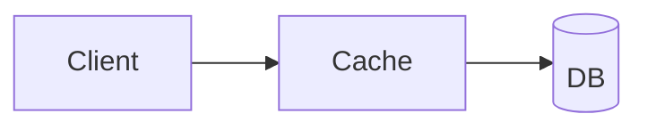

# Caching test guide

> Test fixture.

---

## Contents

- dropped by the builder

---

## ⚡ The 5-minute summary {tldr}

> **Short on time?** Read this.

1. **A cache keeps hot data close.** [Section 1](#sec-1)

---

## 0. Intro {ov}

▶️ [[ts: today we talk about caching]]

> **Key takeaways:**
>
> - Caching trades memory for speed.

The video introduces caching.

```spectrum
- No cache: every read hits the database
- *Read-through cache: most reads served from memory
- Cache everything: stale data risk
```

---

## 1. Cache basics {basic}

▶️ [[ts: a cache keeps hot data close]]

> **Key takeaways:**
>
> - Hits are cheap, misses are expensive.

### 1.1 Eviction

▶️ [[ts: when the cache is full we evict]]

```calc
title: Memory
- 1M keys × 1 KB = 1 GB
```

```timeline
total: 10
unit: min
- Intro: 1
- Basics: 4
- Eviction: the rest
```

```loop
center: Cache
- Read: get key
- Miss: load
- Store: put key
```

```matrix
x: Low traffic | High traffic
y: Hot data | Cold data
- *Cache it: worth it
- Cache it: maybe
- —
- —
```



> **(Explainer's note):** an addition for the test.

> **Common mistakes:**
>
> - "Caching is free": it costs memory.

---

## 2. Glossary {glossary}

| Term | Short definition |
|---|---|
| **Cache** | Fast storage for hot data |
| **Eviction** | Removing entries when full |

---

## 3. Review questions {ref}

1. The cache is full. What happens? {basic}
    - [ ] It crashes
    - [x] An entry is evicted

    **Answer:** Eviction. [Section 1](#sec-1)

2. Why cache at all? {mid}

    **Answer:** Speed.
