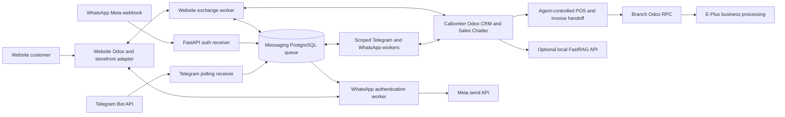

# Callcenter production VPS readiness audit

Audit date: 2026-11-25, Africa/Cairo. Runtime observations and verification were collected around 08:08–08:19 UTC. This is a point-in-time engineering review, not deployment approval.

**Recommendation: NO-GO for moving the current configuration directly to a VPS.** Production audit: **55/100, risky**, based on confirmed credential exposure, unverified VPS-to-branch connectivity, development-specific service wiring, unresolved pilot queue work, and missing current recovery/production acceptance evidence. Passing local tests does not close these gates.

The requested diagnosis and migration preparation are complete. Remediation, production deployment, credential rotation, and production acceptance have not been performed.

## 1. Scope, evidence and limits

Reviewed the Callcenter Odoo addons, both FastAPI gateway implementations, the current messaging workers and durable queue, website adapter source and local website configuration, authentication bridge, branch/POS handoff, key storage/lifecycle, service supervision, backup evidence, and the additional installed FastRAG integration.

Evidence labels used below:

- **Observed:** current local file, service, socket, or read-only database observation.
- **Source:** behavior traced in this checkout or the adjacent website checkout.
- **Historical:** a dated existing report; not fresh production validation.
- **Gate:** work/evidence required before production activation.

Local PostgreSQL inspections used transactions forced read-only with a five-second statement timeout. Output was limited to configuration identifiers, versions, states and aggregate counts. No messages, customer bodies, passwords, bearer values or API-key hashes are included here. Treat this document as internal: it contains infrastructure topology and non-secret account identifiers.

No Odoo upgrades, customer sends, provider changes, webhook changes, branch SQL operations, service restarts, queue reconciliation, credential changes or VPS changes were performed. Only this report was added to the repository. Audit test processes were stopped when necessary; user services were left running.

### Release identity

| Item | Observed value |
| --- | --- |
| Checkout | `/opt/odoo19/worktrees/callcenter19` |
| Branch | `callcenter19` |
| HEAD at review | `9229e3e6` |
| Existing staged work | 32 added files under `fastrag_connector` and `fastrag_installer`; preserved |
| Existing untracked work | `tools/`; preserved |
| Callcenter runtime config | `/opt/odoo19/conf/callcenter19.conf` |
| Actual addons path | `/opt/odoo19/server/addons,/opt/odoo19/worktrees/callcenter19` |
| Odoo database | `callcenter` |
| Odoo data directory | `/opt/odoo19/data/callcenter19` |
| Odoo logfile | `/opt/odoo19/logs/callcenter19.log` |
| Durable messaging queue | PostgreSQL `crm_messaging_callcenter`, schema version 1 |

The shared Odoo `instructions/entrypoint.md` referenced by AGENTS.md is missing. The existing sibling `odoo-core.md` and `odoo-review-rules.md` were located and applied. This report changes no addon code, catalogs or manifests.

## 2. Actual system flow



The diagram shows logical boundaries. Not every arrow uses the FastAPI listener: website exchange and authentication are separate worker processes. Website exchange is initiated by the worker over HTTPS; it is not a new public website webhook into FastAPI.

### CRM and OMS distinction

**Observed:** `ab_oms_core`, `ab_oms_sync`, `ab_oms_branch_adapter` and `ab_oms_website_adapter` are uninstalled in `callcenter`. `queue_job` is also uninstalled there. The current messaging queue is an independent PostgreSQL service; it does not depend on installing Odoo `queue_job`.

`ab_crm_gateway` remains installed, and the old `crm_gateway/` source remains in the tree. Installed legacy addon code is not evidence that its retired worker should run. No legacy gateway runtime unit was found in the inspected CRM service inventory.

Current operational flow:

1. Telegram polling or signed WhatsApp reception writes events durably to the messaging queue.
2. Scoped workers deliver to authenticated Callcenter messaging APIs. Account, provider identity, service user, branch and company are checked server-side.
3. CRM conversations and contacts appear in Sales Chatter; replies require an authorized employee/session and sending eligibility.
4. A website worker fetches source events from the website adapter, persists/processes them, captures them in Callcenter and acknowledges source events through the exchange protocol. v1/v2/v3/v4 support covers order notifications, conversations, lifecycle and media.
5. Website order capture does **not** automatically approve payment, reserve stock, create a POS invoice, or post to E-Plus. Agents use the native handoff and manually prepare the POS/invoice workflow.
6. Branch RPC uses stable operation/request tokens and reconciliation for ambiguous outcomes. Inventory and price validation must remain in the normal business path.
7. Historical CRM orders remain a protected archive. Do not reinstall old OMS modules or replay old events as a migration shortcut.

Source: `ab_crm_messaging/models/messaging.py`, `ab_crm_sales_workspace/models/pos_handoff.py`, `ab_crm_website/models/adapter.py`, `crm_messaging_gateway/app/{worker,website,receiver}.py`, `ab_sales/models/ab_sales_branch_rpc_config.py`. Retirement background: [messaging-legacy-retirement.md](messaging-legacy-retirement.md).

## 3. Services and process ownership

### Current local runtime

| Service | Manager/state observed | Function and important settings |
| --- | --- | --- |
| Callcenter Odoo | Running on port 4092; no loaded `odoo19-callcenter` unit shown | User-managed development runtime; workers=0, cron threads=1 |
| `crm-messaging-callcenter.service` | System; enabled, active | Loopback `127.0.0.1:5088`; actual drop-in runs `app.auth_receiver:create_app` |
| `crm-messaging-callcenter-receiver.service` | System; enabled, active | Telegram polling for `tg-callcenter` |
| `crm-messaging-callcenter-worker.service` | Installed, disabled; not active in inventory | Combined-worker alternative; must not compete with scoped workers |
| `crm-messaging-pilot-telegram.service` | User; active | `app.worker --provider telegram`; `config-telegram.json` |
| `crm-messaging-pilot-whatsapp.service` | User; active | `app.worker --provider whatsapp`; `config-whatsapp.json` |
| `crm-messaging-pilot-website.service` | User; active | `app.website`; `config-website-pilot.json`; depends on local HTTPS pilot proxy |
| `crm-storefront-auth.service` | User; active | `app.auth_worker`; `auth.json` plus `config.json` |
| `crm-website-pilot-https.service` | User; active | Separate local Nginx, private pilot CA/cert paths |
| `crm-messaging-website-pilot.target` | User; active | Groups scoped pilot workers |
| `fastrag.service` | System; active | `/opt/fastrag`, pgvector indexing/API service, separate service user |
| Messaging backup timers | None listed in system or user manager | Backup templates exist in repository but active scheduling was not established |

FastAPI's system drop-in is `/etc/systemd/system/crm-messaging-callcenter.service.d/whatsapp-authentication.conf`. It replaces the base `app.main` entrypoint with `app.auth_receiver`; copying only the base unit would lose authentication callback routing.

The scoped worker `ExecCondition` checks that the combined system worker is inactive at startup. This is not a complete cross-host deployment lock and does not replace an explicit single-owner cutover.

### Ports and local bindings

| Purpose | Observed listener / configured port | Migration implication |
| --- | --- | --- |
| Callcenter Odoo | `0.0.0.0:4092` | Bind privately or restrict ingress behind trusted reverse proxy on VPS |
| Callcenter gevent | Configured 4095; no listener observed | Design/test websocket routing with the chosen production worker mode |
| Local website Odoo | `127.0.0.1:4102` | Local pilot only; production website is a separate origin |
| Website pilot TLS | `127.0.0.1:5443` → 4102 | Must not be copied as a production website destination |
| Callcenter pilot TLS | `127.0.0.2:5444` → 4092 | Website worker currently depends on this local proxy |
| FastAPI | `127.0.0.1:5088` | Keep private; expose only required signed webhook path |
| PostgreSQL | `127.0.0.1:5432` | Keep private; Odoo and queue use separate database identities |
| FastRAG | `127.0.0.1:8111` | Recreate locally or replace with a verified HTTPS endpoint if required |
| POS development | Reserved 4091; no listener shown during observation | Do not assume local POS availability; active branch configs point elsewhere |

Other workstation listeners were outside the CRM audit. This is not a VPS firewall audit. Public reachability of 4092 was not established merely by observing its bind address.

Do not bind test processes to reserved 4091/4092 or stop the user's Odoo process. Future local test/upgrade runs must use an unused pair such as 5069/5072 with workers/cron disabled and the correct isolated database.

## 4. Connections and account mapping

### Protected configuration files

Directory: `/home/abdin_04/.config/crm-messaging/`, observed directory mode 0700; inspected JSON configuration files mode 0600.

| File | Destination and accounts | Current switches |
| --- | --- | --- |
| `config.json` | Callcenter `http://127.0.0.1:4092`, DB `callcenter`; Telegram and WhatsApp | Global sending true; both accounts enabled; WhatsApp sending true |
| `config-telegram.json` | Same Callcenter/queue; `tg-callcenter` only | Enabled, polling, global sending true; Telegram model defaults sending on when omitted |
| `config-whatsapp.json` | Same Callcenter/queue; `wa-callcenter` only | Enabled, reception webhook, global/account sending true |
| `config-website-pilot.json` | Callcenter `https://127.0.0.2:5444`; local and production website sources | Global sending true; both configured website accounts enabled and sending true |
| `auth.json` | Local pilot website plus production website authentication sources | Authentication enabled; `wa-callcenter` sender, Arabic and English template mappings |

All four messaging configuration files point to the same PostgreSQL queue database `crm_messaging_callcenter`. Credentials were checked for presence only, except the README password equality check described in finding B1. Provider token validity, revocation and Meta permissions were not actively tested.

### Odoo account inventory

All listed accounts are mapped to local branch 1/company 1; those numeric IDs are diagnostic identifiers, not portable provisioning instructions. Every account has `legacy_worker_disabled=true`.

| Code | Provider/source identity | Active / enabled / outgoing | Service user |
| --- | --- | --- | --- |
| `tg-callcenter` | Telegram bot `8933526980` | true / true / true | 3594 |
| `wa-callcenter` | WhatsApp phone-number ID `965292690006920` | true / true / true | 3595 |
| `website-pilot` | `0185e375-29f9-427c-b6ba-91ce5138425b` | true / true / true | 3596 |
| `website-production` | `a4e63f7a-c5d5-4d13-927b-0a40c287253f` | true / true / true | 3596 |
| `website-production-current` | `2f3d9e8a-a652-4203-b440-eff49207a3a4` | false / false / false | 3596 |
| `website-production-reinstalled` | `62c18ac9-3a5b-472d-a75c-86d8edb575f5` | true / true / true | 3596 |

The current website worker config contains only `website-pilot` and `website-production-reinstalled`. The original `website-production` account remains enabled in Odoo but is absent from that worker config. Preserve its history and reconcile its intended status; do not reactivate it by copying an old example.

### Website destinations

| Account | Worker destination | DB | Backend order-link origin |
| --- | --- | --- | --- |
| `website-pilot` | `https://127.0.0.1:5443` | `e_commerce` | `http://127.0.0.1:4102` |
| `website-production-reinstalled` | `https://store.abdinpharmacies.com` | `ecom19` | `https://store.abdinpharmacies.com` |

Local website DB observations: adapter `19.0.1.5.4`, storefront `19.0.1.0.1`, WhatsApp auth `19.0.1.0.0`, all installed. Its single source `0185e375-29f9-427c-b6ba-91ce5138425b` has intake/chat/outgoing enabled. This says nothing about the remote website's currently installed versions or endpoint flags; those were not queried during this audit.

Authentication source UUIDs differ intentionally from website order/chat source UUIDs:

- Local auth source: `9597e5df-82d2-4762-89cd-0ccf21a24210`, local HTTPS website, `e_commerce`.
- Production auth source: `6380a565-0271-4732-85db-eb7cb8ac067f`, production website origin, `ecom19`.

Do not substitute order-source identities into authentication configuration.

### Branch, stock and external dependencies

Two active ready branch RPC records were observed:

| Local record | RPC origin | DB | Store mapping | DB serial |
| --- | --- | --- | --- | --- |
| 7 | `https://192.168.2.230` | `branch19` | 104 | 120 |
| 193 | `https://192.168.2.230` | `branch19` | 135 | 120 |

These are two store mappings to one private host, not proof of an erroneous duplicate. VPS routing, VPN/overlay access, certificate identity, remote readiness and stock snapshot freshness remain unverified. No branch connection or invoice submission was performed.

Callcenter configuration also references B-Connect database `genius`, a configured external server address, DB serial 102 and decryption material. These must be inventoried privately with the operations owner. Do not transfer decryption keys in this report or change DB/store serials to make connectivity appear successful. The branch RPC DB serial 120 and Callcenter config serial 102 belong to different configuration contexts and require mapping verification rather than automatic normalization.

Native sales also has printer, reporting and external connector dependencies. Printer credentials, branch SQL availability, stock replication schedules, payment-provider live configuration, SMTP delivery and production DNS/TLS were not certified here.

## 5. Keys, authentication and trust boundaries

| Secret/identity | Current location or consumer | Required production treatment |
| --- | --- | --- |
| Callcenter PostgreSQL password | Odoo config | Separate least-privilege DB role; private config; encrypted backup |
| Queue PostgreSQL password | Protected gateway JSON files | Rotate exposed current value; update every scoped config consistently |
| Odoo database manager master password | `admin_passwd` in Odoo config | Unique strong production secret; restrict database management routes |
| Callcenter service API keys | Top-level/per-account `odoo_key` | Dedicated service users; bounded lifetime; account scope; revoke old host access after handover |
| Website exchange API key | Website account `token` | Dedicated website exchange service; source/company scope; preserve source UUID |
| Website authentication API token | `auth.json` source entries | Separate from order/chat exchange; verify expiry and dedicated auth permissions |
| Telegram bot token | Odoo-managed token source | Preserve correct bot identity; never start competing pollers |
| WhatsApp access token | `config.json` and `config-whatsapp.json` | Verify business/phone scope, expiry and revocation; update protected copies together |
| Meta app secret | Webhook secret, including protected private material | Preserve raw-body HMAC verification; rotate privately if exposed |
| Meta webhook verify token | Protected account config | Distinct random challenge secret; prevent query-string logging |
| Branch Odoo API keys | `ab_sales_branch_rpc_config.api_key` | Admin-only field in source, non-exportable; re-enroll/verify against correct branch and store |
| B-Connect credentials/decryption key | Odoo config/connector configuration | Private provisioning; maintain existing encryption/data compatibility |
| TLS private keys and CA bundles | Local pilot paths; future proxy certificate store | Replace pilot dependency with production trust configuration and renewal monitoring |
| FastRAG API key | `fastrag.api_key` system parameter | Independent key; verify destination binding and TLS before use |
| FastRAG DB and model-provider keys | Protected FastRAG service config | Not read during this audit; separately provision/validate if included in release |

**Observed API-key lifecycle:** `callcenter` has 10 API-key records, two expired and three without expiry. Telegram service user 3594 has two records (one expired, one without expiry); WhatsApp service user 3595 has one without expiry; website service user 3596 has two with bounded expiry and neither expired at observation. This does not identify which plaintext key is in use or prove any configured key is currently valid. No hashes or key values were read into this report.

**Source protections observed:** bearer-only machine controllers, operation/envelope allowlists, account/provider matching, service-user restrictions, branch/company checks, immutable account mapping, deduplication/fingerprints, durable queue ingestion, outgoing attempt/receipt checks, media limits and private attachments, CSRF on employee upload endpoints, and website customer ownership/capability checks. These are positive design evidence; effective production ACLs, role membership and direct RPC isolation still require acceptance testing.

Relevant files: `ab_crm_messaging/controllers/gateway.py`, `ab_crm_messaging/models/messaging.py:481`, `ab_crm_messaging/security/record_rules.xml`, `ab_crm_website/controllers/adapter.py`, `ab_crm_website/security/security.xml`, and website adapter `controllers/chat.py` / `models/adapter.py` in the ecommerce checkout.

## 6. API and proxy contract

| Boundary | Routes / protocol | Exposure rule |
| --- | --- | --- |
| FastAPI liveness | `GET /health` | Private; confirms process only |
| FastAPI queue readiness | `GET /ready` | Private; checks queue schema reachability, not website/Meta/branch health |
| WhatsApp challenge/intake | `GET/POST /webhooks/whatsapp/wa-callcenter` | Exact signed webhook path via public TLS proxy |
| Callcenter messaging | `/crm/messaging/v1/<operation>` | Bearer + database header + dedicated service scope |
| Callcenter capabilities and selected API operations | `/json/2/ab_crm_messaging_api/<method>` | Worker-required authenticated routes; not a public anonymous RPC proxy |
| Website intake into Callcenter | `/crm/website/v1..v4/receive` | HTTPS and bearer; worker to Callcenter |
| Website exchange | `/storefront-callcenter/v1..v4/<operation>` | HTTPS/bearer to website, source identity required |
| Website media | Versioned media routes on both Odoo applications | Preserve exact method, headers, bounds and private authorization |
| Staff order link | `/odoo/storefront-callcenter/backend-order/<source>/<order>` | Website staff login and normal order/company permissions; no cross-server SSO |
| WhatsApp authentication | Separate source exchange and callback routing | Keep auth receiver drop-in and worker; OTP status must not enter staff chat |

`crm_messaging_gateway/deploy/nginx.conf` is a **template**, with placeholder hostname/certificates. It allows only the exact WhatsApp path, sets a 1 MiB request limit and disables access logging. It is not evidence of a deployed VPS proxy. Preserve raw webhook bytes, signature headers and challenge query parameters. A success response must follow durable ingestion.

The webhook-only template must not be mistaken for the complete Callcenter Odoo reverse proxy. The website worker also needs its authenticated Callcenter routes, media transfers and capabilities calls. Configure appropriate distinct upload limits for those routes; a blanket 1 MiB limit would break larger supported media.

For the VPS, terminate TLS at a trusted proxy, restrict direct Odoo/FastAPI/DB access, set `proxy_mode` correctly, reject untrusted forwarded-header sources, disable database listing, scope `dbfilter`, configure websocket routing for the chosen worker mode, and validate certificate renewal. Rate limits must preserve provider retry semantics and normal employee use. Production controls have not been inspected.

## 7. Queue, reliability and current backlog

Queue schema version 1 is present; local FastAPI `/health` and `/ready` both returned HTTP 200. Telegram heartbeat age was 1–26 seconds across observations, below the source's 120-second unhealthy threshold.

| Account | Incoming state/count | Outgoing state/count |
| --- | --- | --- |
| `tg-callcenter` | done 67 | done 40 |
| `wa-callcenter` | done 100; ignored 12 | done 26 |
| `website-pilot` | done 57; pending 1; review 1 | done 19; ready 1 |
| `website-production` | done 1 | No rows observed |
| `website-production-reinstalled` | done 28 | done 2 |
| Production auth source | done 7 | Separate auth protocol; not counted as ordinary outgoing rows here |
| Local auth source | done 13 | Separate auth protocol; not counted as ordinary outgoing rows here |

One `website-pilot` outgoing row is state `done` **with outcome status `review`**. Inspect outcome as well as transport state. The oldest non-final incoming pilot work was about 239,000 seconds old, approximately 66.5 hours. These rows were not modified, replayed, acknowledged or deleted during the audit.

Production-source completed counts prove local historical processing records exist. They do not establish fresh end-to-end production delivery or remote endpoint health.

Migration must preserve event keys, fingerprints, source UUIDs, offsets, operation tokens, attempts, receipts, provider references, leases and review evidence. Recover uncertain sends into review; never reset them to ready automatically. Preserve historical and ignored records. Do not copy just Odoo's database and start a fresh empty queue for existing accounts.

## 8. Prioritized findings and release gates

| ID / severity | Finding and evidence | Impact | Smallest required correction / owner |
| --- | --- | --- | --- |
| B1 / Critical | Tracked `README.md:30` contains a plaintext queue DB password. A local comparison confirmed it equals the current `config.json` queue password. | Repository/document exposure grants a real credential, subject to DB network access. | Security/DB owner: rotate it, update all private queue configs, remove plaintext from docs/release artifacts and scan history/artifacts privately. Do not paste the replacement. History rewriting requires its own coordinated decision. |
| B2 / High | `ab_sales/models/ab_sales_branch_rpc_config.py:175` uses `verify=False` and suppresses certificate warnings. | A reachable impersonating branch endpoint can receive bearer credentials and business payloads or falsify responses. | Connector owner: enable verified certificates using a trusted CA/hostname; prove branch RPC and failure behavior before shipment. No source fix applied here. |
| B3 / High | Both active ready RPC mappings use private `192.168.2.230`; no VPS route/stock evidence. | CRM may work while invoice/stock operations fail after migration. | Network/POS owner: provision private routed access and prove both store mappings, intended serial, inventory snapshot and authorized operation reconciliation from VPS. |
| B4 / High | Website worker uses `https://127.0.0.2:5444`, private pilot CA, local website account and user service dependencies. | Copying the current files can point production at the wrong instance or fail TLS/startup. | Platform owner: create production-only protected configuration, verified origins and dedicated system units; retain old history without running pilot intake on VPS. |
| B5 / High | Global/account sending is true for Telegram, WhatsApp and both configured website sources; old website source also remains enabled in Odoo. | Starting copied workers can send/replay without an intentional handover. | Integration owner: define source/account activation matrix; start new workers gated off; quiesce old owners before transferring queue ownership and enabling new workers. |
| B6 / High | Pilot queue has pending, review, ready and completed-with-review-outcome rows. | An apparently completed migration can strand or replay uncertain work. | Messaging owner: use supported preview/reconciliation with provider/Odoo evidence; preserve audit and original identities; classify pilot-only rows before cutover. |
| B7 / High | No CRM backup timers found in either manager. Newest visible file in the inspected backup directory is 2026-11-11. No new full restore drill. | Recovery after migration is not demonstrated. | DB/platform owner: new matching DB/filestore/source/config/queue backup; encrypted off-host retention; isolated restore drill with counts, digests and uncertain-send preservation. Other backup locations may exist and were not certified. |
| B8 / High | Core delivery workers run as user pilot units; Odoo is development-managed. | Workstation session/boot assumptions, paths and mixed managers may prevent reliable VPS startup. | Platform owner: dedicated service users, explicit ownership/modes, boot supervision, health alerts and a selected worker topology. Test reboot recovery without duplicate ownership. |
| B9 / High | Remote website versions, flags, service roles, VPS firewall/DNS/TLS and cross-server acceptance unverified. | A green local suite can conceal incompatible deployed endpoints or company access. | Release owner: stage exact release on VPS and verify all acceptance gates below. Do not treat old November reports as current remote state. |
| F10 / Medium | Callcenter binds all interfaces on 4092; no VPS ingress review. | Direct access could bypass intended proxy controls if firewall permits. | Platform owner: private bind/firewall, trusted proxy routing, database manager restrictions and externally verified exposure. Current internet exposure is not proven. |
| F11 / Medium | Service-key inventory includes expired and non-expiring records. | Rotation debt and accidental use of stale credentials during transfer. | Security owner: identify current key by controlled authenticated capability checks, record expiry/owner, rotate deliberately and revoke unused keys. Expired records alone do not prove active auth is broken. |
| F12 / Medium | Historical guide contains a broader browser `website_target` null error; production E2E not rerun here. | Focused route tests may miss action-switching failures. | QA owner: reproduce or close through the current browser matrix, including Arabic/mobile and navigation switching. This is historical evidence, not a reproduced defect in this audit. |
| F13 / Medium | FastRAG connector is installed while its source and installer are staged additions; local URL is loopback 8111. | Release may omit a live dependency, leak AI keys, or unintentionally enable model egress. | Release owner: explicitly include and validate FastRAG, or keep its optional UI unused; decide before packaging. |
| F14 / Low | README links several architecture/setup documents absent from this checkout; old rollout notes describe disabled flags now enabled. | Operators may follow stale architecture or activation instructions. | Documentation owner: use this snapshot and current status-link guide; reconcile older documents after the deployment decision. |

## 9. Release and dependency inventory

Local installed versions match inspected Callcenter manifests for:

| Addon | Version |
| --- | --- |
| `ab_crm_core` | `19.0.1.1.0` |
| `ab_crm_gateway` | `19.0.1.0.0` |
| `ab_crm_messaging` | `19.0.1.12.0` |
| `ab_crm_telegram` | `19.0.1.2.0` |
| `ab_crm_whatsapp` | `19.0.1.0.0` |
| `ab_crm_sales_workspace` | `19.0.1.42.0` |
| `ab_crm_whatsapp_workspace` | `19.0.1.9.0` |
| `ab_crm_website` | `19.0.1.16.1` |
| `ab_sales` | `19.0.4.1.22` |
| `fastrag_connector` | `19.0.1.0.0` |

Manifest dependency closure for `ab_crm_website`, `ab_crm_whatsapp_workspace` and retained `ab_crm_gateway` includes 21 custom addons:

`ab_contract`, `ab_costcenter`, `ab_crm_core`, `ab_crm_gateway`, `ab_crm_messaging`, `ab_crm_sales_workspace`, `ab_crm_telegram`, `ab_crm_website`, `ab_crm_whatsapp`, `ab_crm_whatsapp_workspace`, `ab_customer`, `ab_employee_access`, `ab_employee_access_sales`, `ab_eplus_connect`, `ab_hr`, `ab_product`, `ab_sales`, `ab_store`, `ab_whatsapp_api`, `ab_widgets`, `abdin_et`.

Core dependencies include `base`, `mail`, `web` and `rpc`. This is a minimum dependency closure, not a complete list of every installed operational sales extension. Export an approved installed-module inventory privately before constructing a production package; validate required sales/printing/delivery/custom extensions too.

Gateway lockfile: `crm_messaging_gateway/requirements.lock`; dev test dependencies: `requirements-dev.txt`. Do not use `crm_gateway/requirements.lock` as a substitute for the current messaging gateway. Python/binary addon dependencies observed include Pillow (`PIL`), `phonenumbers`, `requests` and `ffprobe`. Local `ffprobe`, `pg_dump`, `pg_restore` and `wkhtmltopdf` binaries exist; VPS availability and compatibility still need validation. Connector-specific SQL drivers must match the target runtime.

Package exact reviewed addon/gateway revisions with checksums. Exclude credentials, private configs, CA private keys, dumps, logs, local virtual environments, caches, test data, unrelated tools and development-only evidence. Preserve English UI strings and both Arabic catalogs. Record Odoo server revision, Python runtime, PostgreSQL version, SQL drivers and OS packages in the eventual release manifest.

### FastRAG is a distinct optional service

Observed: active `fastrag.service`, `/opt/fastrag`, service user `fastrag`, `pgvector` indexing/API description, localhost listener 8111; Callcenter `fastrag.base_url=http://127.0.0.1:8111` and API-key parameter present. The generated installer reads `/opt/fastrag/config/config.pgvector.yaml` at runtime. That protected configuration was not inspected, and the audit did not exercise AI generation, indexing or external model requests.

The staged connector supports TLS verification by default but also has `FASTRAG_SKIP_TLS_VERIFY`; keep verification on for non-loopback production access. Its installer bundle is generated from canonical FastRAG source, not the source of truth for ad hoc patches. If shipping it, privately inventory its PostgreSQL/pgvector storage, server key, model-provider key, allowed data/egress, backups and indexing worker recovery. Never run the privileged installer merely to validate a release bundle.

## 10. Validation performed

| Check | Result | Limit |
| --- | --- | --- |
| Branch/status/addons/config review | Completed | Existing changes preserved; no source remediation |
| Read-only Callcenter/website module and mapping queries | Completed | Local databases only |
| Read-only durable queue states and heartbeat | Completed | Snapshot; no payloads exported |
| FastAPI `/health` and `/ready` | HTTP 200 each | Dependency and business health beyond queue not covered |
| Gateway regression suite | **323 passed, 28 skipped, 1 warning**, 7.03 s | Mocked providers and temporary SQLite; live PostgreSQL test DSN deliberately unset |
| Focused provider/receiver/config tests | 86 passed, 1 deselected; deselected ASGI test then passed separately | Covered again by final complete gateway run |
| Service/socket/timer inventory | Completed | Current local host only |
| Recent Odoo log sample | Last 10,000 lines: 0 ERROR, 0 CRITICAL, 0 traceback; 4 warnings | Sanitized counts only; not full historical log analysis |
| Visible protected backup inventory | Completed | Does not establish successful restores or all possible backup systems |
| Binary presence | `ffprobe`, `pg_dump`, `pg_restore`, `wkhtmltopdf` present | Presence is not target VPS compatibility |

The first restricted-sandbox test attempt stalled in the Starlette/AnyIO TestClient path. A bounded targeted run located the wait; the same test passed outside the sandbox, followed by the complete suite above. The initial attempt was stopped and is not counted as a pass. The final suite warning concerns the runtime's deprecated Starlette TestClient/httpx pairing; no dependency changes were made.

Final gateway command, from `crm_messaging_gateway/`:

```bash
env -u MESSAGING_TEST_DSN_FILE \
  PYTHONDONTWRITEBYTECODE=1 \
  PYTEST_DISABLE_PLUGIN_AUTOLOAD=1 \
  PYTHONPATH=/tmp/chat-lifecycle-validation/gateway-deps \
  timeout 120 /home/abdin_04/.config/crm-messaging/venv/bin/python -B \
  -m pytest tests -q -p no:cacheprovider
```

That `/tmp` dependency location was an existing local QA installation, not a production dependency path. For repeatable CI/staging, build an isolated environment from reviewed lockfiles. PostgreSQL fixtures can truncate an isolated test DB and must never receive the live queue DSN. The 28 skips are retained as incomplete coverage; they are not production successes. No fresh Odoo registry/security suite, browser E2E, PostgreSQL failover/restore or actual provider delivery test was performed.

## 11. Proposed VPS deployment sequence

These are operator gates, not executed actions. Keep credentials and exact VPS access details in a private inventory, separate from this report.

### Phase A — approve and freeze the release

1. Assign owners for platform, database, messaging/provider, website, branch/POS, QA and go/no-go. Record the actual Callcenter VPS, DNS name, OS, resources, storage, SSH route and service account. The website production origin does not identify the future Callcenter VPS.
2. Resolve B1 credential exposure and B2 branch TLS verification. Review staged FastRAG separately and select the exact release commit/package. Preserve existing uncommitted work; do not deploy the workstation directory wholesale.
3. Choose whether the production Callcenter DB is a controlled migration of `callcenter` or a fresh provisioned installation. A fresh install still needs deliberate source/history/queue ownership decisions. Do not copy development users, pilot sources, credentials and sends without review.
4. Record complete installed modules, selected business extensions, dependency locks, checksums, source UUIDs, account/service/branch/company mappings and expected API capabilities. Decide a topology: dedicated scoped workers or one combined messaging worker, with exactly one receiver owner and one website/auth owner per source.

### Phase B — provision without live intake or sending

1. Create dedicated service users, private directories and file modes. Install pinned runtime dependencies, PostgreSQL queue and required Odoo/connector dependencies. Use a distinct queue DB/role.
2. Configure verified TLS origins, private listeners, firewall, DNS and controlled access to branch `192.168.2.230`. Confirm routing to both intended stores before enabling sales operations.
3. Create production-only private configuration with loopback pilot sources excluded from polling/sending. Preserve source identifiers for migrated production history. Configure website `token`, Callcenter `odoo_key`, database headers and separate auth source/token mappings correctly.
4. Port the actual authentication receiver entrypoint, scoped workers, website/auth workers, backup scheduling and monitoring to dedicated system units. Replace `/home/abdin_04` and pilot CA assumptions. Review `StateDirectory`, `ReadWritePaths`, file ownership and `ProtectSystem` against actual data/backup paths.
5. Stage Odoo with intake/outgoing disabled. Verify manifest dependencies and registry. Use isolated databases for validation and unused HTTP/gevent ports; do not upgrade a live DB concurrently with running Odoo workers. Never use `-u base` as a blanket fix.

### Phase C — recovery rehearsal

1. Quiesce changes in a coordinated maintenance window when taking the authoritative cutover backup. Back up Callcenter DB and matching filestore, addon/gateway release, protected configs, queue DB, and required website metadata/source package. Capture provider offsets and unresolved operation classification.
2. Encrypt backups and retain an off-host copy with access controls and documented retention/RPO/RTO. The observed Callcenter filestore is about **1.1 GiB**; allow additional room for DB, queue/media, logs, working space and restore copies. This is not a full VPS sizing estimate.
3. Restore into isolated Odoo/queue databases and private ports, with cron/provider sends disabled. Check counts/digests, module registry, attachments, source mappings, polling offsets and uncertain-send states. A `pg_restore --list` archive listing is not a restore drill.
4. Record the recovery duration and a precise rollback decision point. Do not move to activation until the drill succeeds.

### Phase D — controlled ownership transfer and activation

1. Record high-water marks and planned pending/review handling. Stop only the named old delivery owners during the approved cutover, including website/auth workers and Telegram receiver; let active work settle or classify uncertainty. Odoo process handling remains an operator-controlled maintenance action.
2. Take the final consistent queue/state transfer after old workers are quiescent. Avoid dual-running old and new hosts against separate queues with the same provider/source. Queue row locks in one DB do not protect two independently restored queues.
3. Start the VPS gateway and dependency checks with new sending disabled. Confirm only the intended accounts/source identities are loaded. Repoint the exact Meta callback only after signature/challenge and durable-ingest tests pass.
4. Activate inbound first and then approved outbound tests, per channel. Require explicit named test participants for actual customer/provider sends. Activate website intake/chat/outgoing according to the agreed notification-only or full-chat mode on both sides; do not infer remote settings from local flags.
5. Verify one current event traverses each boundary exactly once, then monitor backlog age, review outcomes and receipt progression through an agreed soak window. Revoke old host credentials only after successful verification and confirmed rollback implications.

## 12. Production acceptance matrix

Every row needs dated evidence from the real staged/VPS topology and an owner sign-off. None is waived by the local suite.

| Area | Required acceptance | Pass condition |
| --- | --- | --- |
| Boot/supervision | Reboot, dependency outage and worker restart | All intended services recover; no duplicate old/new workers or polling owners |
| Odoo access | Staff, service user, manager, wrong-company/branch and revoked role | Direct RPC and UI both enforce intended permissions; service account cannot browse unrelated CRM/sales data |
| Keys | Valid, expired, revoked and replacement credentials | Expected denial/recovery; no key/body values in logs or browser traffic |
| Telegram | Single poller, offset persistence, disconnect/restart, explicit reply | No lost/duplicated inbound event; one authorized send; fresh heartbeat |
| WhatsApp ingress | Challenge, valid raw HMAC, forged/modified body, wrong phone, replay/conflict | Rejection where required; success only after durable commit; identity conflicts retained safely |
| WhatsApp reply | Window/template policy, authorization, delivered/read ordering, ambiguous timeout | One canonical operation; monotonic receipt evidence; uncertain outcome requires review |
| Website order capture | Fresh order, outage/backlog/retry and source ACK | One source event/capture/ack; checkout remains governed by native payment/price/stock flow |
| Website conversation | Customer/order/native chat separation, ownership, lifecycle, replies and media | No cross-customer/order leakage; target selection stable; closure/retry behavior correct |
| Staff order link | Two different orders, login return, portal denial, wrong company | Each opens its own permitted website order; no SSO assumption or sudo access bypass |
| POS/invoice handoff | Both mapped stores, unit/delivery/customer mapping, stock snapshot, timeout/reconcile | Correct branch/company/pricing; stable request token; no duplicate invoice or unintended stock write |
| Website authentication | Approved test login/OTP, expiry, replay/rate limit, provider callback | OTP/auth status remains separate from staff conversations; failure is recoverable and audited |
| Arabic/mobile | Arabic and English, narrow viewport, action switching and attachment UI | Usable inbox/composer/order links; both catalogs correct; historical null-target issue closed or explicitly accepted |
| Failure recovery | Odoo down, queue down, website down, Meta unavailable | Safe retries and alerts; no blind replay of unknown sends |
| Backup/restore | Full isolated restore and matching attachments/source/config/queue | Documented RPO/RTO achieved; audit/offsets/review preserved |
| Observability | Missing poller, aged backlog, review outcome, full disk, cert/key expiry | Actionable alerts reach named owner without secrets or customer bodies |
| FastRAG, if included | Key denial, storage/model egress, indexing recovery, backup | Intended data boundary and service recovery verified; optional feature cannot break CRM |

Production payment settlement, delivery-carrier availability, email deliverability, printer access and external stock replication each need their own operational acceptance if included in launch scope.

## 13. Monitoring, rollback and stop criteria

Monitor process health **and** queue readiness, oldest pending age per account, stale Telegram polling (>120 seconds), website fetch/ack progress, outgoing unknown/review outcomes even when state is `done`, provider errors, auth backlog/expiry, storage use, certificate renewal, key expiry and backup success/restore evidence. `/health` alone is insufficient.

Stop activation on unauthorized data access, invalid branch/store mapping, price/stock mismatch, duplicate posting/sending, growing unresolved backlog, missing durable ACK, unverifiable TLS, mismatched source UUID or failed restoration.

Rollback procedure:

1. Pause the affected new receiver/worker and outgoing switches; preserve all current queue/audit/provider evidence. Keep unrelated channels operational when safe.
2. Establish whether a provider send or branch invoice may already have happened. Reconcile with original tokens/references before retrying.
3. If reverting runtime source/config is enough, restore the previous compatible release while preserving current queue state. Ensure only one delivery owner exists before resuming.
4. If DB rollback is required, use matching DB/filestore/source/config backups in a maintenance window and reconcile all post-backup business transactions. Do not overwrite the current queue with an old dump and replay completed sends.
5. Preserve current/historical source UUIDs and archives. Do not uninstall/reinstall website adapters, delete orders, remove stock records or enable retired OMS/direct-send paths to recover service.

## 14. Remaining evidence and decisions

- Actual VPS inventory/access, DNS and production Odoo/Gateway proxy configuration.
- Network path and verified TLS to branch/POS; readiness of both mapped stores and stock sources.
- Approved fresh-install versus DB-migration strategy, pilot-history handling and source activation matrix.
- Fresh remote website versions, endpoint flags, livechat bridge membership where enabled, service permissions and key validity.
- Current full backups, off-host retention, restore results and signed rollback ownership.
- Isolated PostgreSQL queue tests, Odoo authorization suites, browser E2E and approved live-channel soak from the target topology.
- Explicit FastRAG inclusion/exclusion and protected dependency inventory if included.

The next concrete action is to rotate the confirmed exposed queue password and remove it from the tracked README, then close branch TLS/network and recovery gates before scheduling the VPS handover.

## 15. Supporting repository references

- [Current website connection guide](website-callcenter-production-setup.md) — architecture and provisioning, with older local-state descriptions.
- [Current staff order-status links](website-order-status-links.md) — adapter/receiver versions and access behavior.
- [Omnichannel runbook](omnichannel-callcenter-runbook.md) — PostgreSQL queue, recovery and channel controls.
- [Messaging retirement record](messaging-legacy-retirement.md) — retired OMS and protected history.
- [Production notification historical record](website-notifications-production-2026-11-23.md) — reinstall/source history; its disabled flags are not the current local state.
- [Storefront authentication setup](storefront-production-authentication-setup.md) — authentication source mapping, separate from order/chat exchange.
- [Gateway development notes](../crm_messaging_gateway/DEVELOPMENT.md), [authentication notes](../crm_messaging_gateway/AUTHENTICATION.md), and [deployment templates](../crm_messaging_gateway/deploy/).

Historical reports remain useful evidence, but they do not certify the present production website, the future VPS, or changes made after their dated checks.

## 16. Messaging ownership and timing explained

FastAPI does not manage the entire flow by itself. The HTTP application receives signed WhatsApp webhooks and authentication callbacks and durably queues them. Separate Python processes receive Telegram updates, exchange website events, send replies and deliver authentication messages. Those processes use the gateway application code but do not pass every exchange through the FastAPI HTTP listener. PostgreSQL stores durable queue state; Odoo owns CRM history, account/employee/branch/company authorization and outgoing business operations. Nginx provides TLS/proxying. FastRAG is a separate optional AI service.

Incoming WhatsApp: Meta → HTTPS proxy → FastAPI signature/identity validation → PostgreSQL queue → WhatsApp worker → Callcenter Odoo → agent browser refresh.

Incoming Telegram: Telegram long-poll response → dedicated receiver → PostgreSQL queue plus durable offset → Telegram worker → Callcenter Odoo → agent browser refresh. The `timeout: 30` in Telegram polling is a maximum wait for an empty long-poll request, not a fixed 30-second delay on every new message.

Incoming website: source website saves an event → website worker fetches it over HTTPS → durable queue → Callcenter capture → source acknowledgement → agent browser refresh. Website replies travel through an authorized Odoo outgoing operation, durable receipt, send authorization, website exchange and delivery reporting. Telegram/WhatsApp replies follow the corresponding provider send path. Website OTP/authentication has its own worker and source protocol; its callbacks are routed separately from staff chat.

### Timing built into the current code

| Stage | Source behavior | Effect under light load |
| --- | --- | --- |
| Telegram/WhatsApp worker | One incoming claim and at most one outgoing dispatch per tick; unconditional one-second sleep after tick | Up to about one second of idle-cycle wait, plus all work in the cycle |
| Website worker | Fetches enabled accounts/protocols sequentially, then one incoming event and at most one outgoing dispatch; two-second sleep after tick | Up to about two seconds of idle-cycle wait, plus sequential HTTPS and Odoo work |
| Authentication worker | Sequential source processing, then one-second sleep | Own scheduling/network delay, independent of staff message delivery |
| Callcenter workspace and notification service | Five-second periodic refresh/poll | Can add nearly five seconds of visible UI delay after Odoo already has the message |
| Error recovery | Odoo-unavailable incoming deferral is 30 seconds; other failures have backoff/review paths | Deliberate additional delay; not normal successful-message timing |

These are scheduling facts, not measured end-to-end latency. Network round trips, queue backlog, media downloads/uploads, database work, provider delivery and browser activity add time. For example, a new WhatsApp message that just misses a worker cycle and browser refresh can spend roughly six seconds in those two scheduling waits alone. Website can add roughly seven seconds in worker/UI waits alone. Neither is an SLA or upper bound.

One-event-per-tick processing limits backlog drainage even if reception fetches batches: a single channel worker cannot sustain one incoming event per second once cycle work is included, and the current website worker cannot sustain one incoming event every two seconds once its cycle work is included. Status/lifecycle events also consume processing. A burst of 60 events therefore takes roughly a minute or more on a one-second worker, or roughly two minutes or more on the website worker, before considering network/media/other cycle costs. This is a code-derived illustration, not a benchmark. Existing queues enforce per-destination ordering and may intentionally block behind unresolved work.

### Proposed performance work, in priority order

1. Measure event creation, queue commit/claim, Odoo commit, provider acceptance, UI visibility and receipt times separately. Report median/p95/p99, queue ages and backlog drain under realistic text/media traffic. Existing gateway/Odoo/provider latency log hooks help but do not by themselves measure the complete customer-to-screen path.
2. Isolate the production website worker from local pilot accounts. Its present sequential fetch loop means a slow pilot destination can delay production processing and replies in the same worker.
3. Drain a bounded batch of ready work per cycle; sleep when idle and keep incoming/outgoing/reporting fair. Reuse existing deduplication, leases, send authorization, per-destination ordering and uncertain-outcome handling. Benchmark this change on isolated databases before rollout.
4. Send authorized Odoo bus/websocket notifications after commit to refresh affected browsers promptly, retaining periodic polling as recovery. Existing browser-local `env.bus` events are not server-to-browser message delivery. Proper websocket proxy/service setup is a prerequisite.
5. Consider PostgreSQL notification-based worker wakeups or another durable-queue-compatible signal after the simpler changes are measured. Keep the durable table as truth and polling/recovery as fallback.
6. Add concurrency across independent accounts/conversations only after proving queue leases, ordering and duplicate-send safety under load. Avoid adding competing Telegram receivers or blindly multiplying workers.

Reducing every timer globally or buying a larger VPS alone does not remove sequential work, one-event-per-cycle limits or five-second UI polling. Keep durability and authorization checks; optimize scheduling, batching and independent work instead.

Source anchors: `crm_messaging_gateway/app/worker.py:221`, `crm_messaging_gateway/app/website.py:311`, `crm_messaging_gateway/app/receiver.py:33`, `crm_messaging_gateway/app/auth_worker.py:96`, `crm_messaging_gateway/app/storage.py:103`, `ab_crm_sales_workspace/static/src/workspace.js:133`, `ab_crm_sales_workspace/static/src/session_service.js`.
